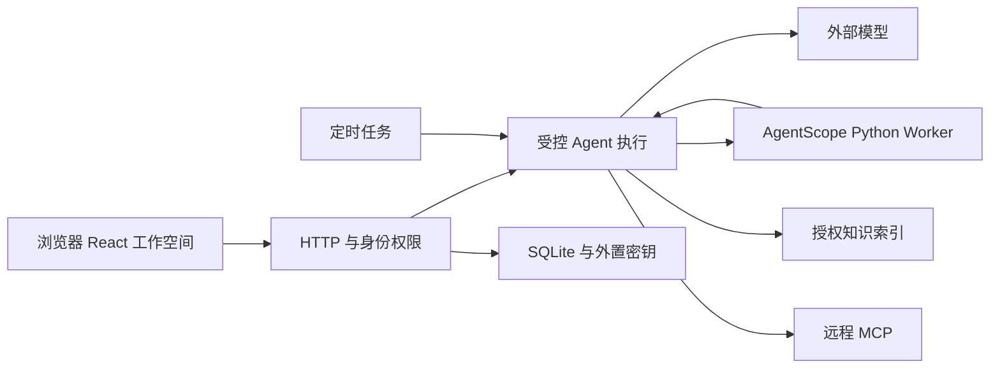

# 项目架构与设计

## 运行形态

浏览器运行 React 工作空间；一个 Express 进程负责身份、资源、Agent、持久执行队列和定时调度；SQLite 保存业务状态。外部模型负责提出分析与工具请求，MCP 提供真正的远程能力。生产部署同源提供 dist 与 API，仍只支持一个应用副本。

本机可另部署两套独立服务：观测栈接收固定字段 OTLP 并抓取多个独立数据库工作空间的 metrics；代码沙箱通过受治理 MCP 接收已审批的固定 Python 源码，由 socket broker 管理每轮容器、扫描和独立产物批准。它们不改变 SQLite 单实例边界，不向 Worker 开放 Docker socket；接入见[观测说明](../deploy/observability/README.md)和[沙箱说明](../integrations/agent-sandbox/README.md)。

AgentScope 是唯一编排运行时。默认由预加载 Python 3.12 / AgentScope 2.0.8 的父进程池为每轮 fork 独立子进程，经私有 stdio 请求 Node 的模型与工具回调；cold 模式也运行相同 SDK。业务上下文仅在 fork 确认后发送，完成回收才复用父进程。API 入口始终先预热再监听，readiness 始终包含 Worker，增强暂停也不能跳过 Python。模型出口、权限、审批与持久执行治理仍由 Node 承担，实际边界见 [运行指南](agentscope-runtime.md)。

第四期增强位于共享 Node 层：agent-context 在运行前按预算选择完整历史轮次，retrieval 可选择多文档非重叠片段，evidence-report 在生成消息时读取步骤账本构造快照；三项独立默认关闭，不改变 Worker 协议、巡检判定或审批真值。证据报告存入原消息 metadata，前端展开/导出，不增加存储服务或模型调用。

第六期独立复核由 `server/agent-review.mjs` 实现，聊天请求显式开启后在分析结束时顺序启动第二个 AgentScope Worker 上下文。复核没有工具权限，不继承分析的系统指令或供应商 reasoning；只检查同一请求的候选答案和已有证据。Node 验证严格枚举 JSON，通过才发布分析答复，否则发布固定说明。分析最多五次、复核最多一次，共用执行预算/超时/取消；此复核流程自身没有新增表或自主委派；可选自主委派由独立模块处理。复核结果与统计存入 `metadata.agentReview`，不替代审批或巡检真值，也不能阻止此前的查询。

普通聊天的文本通路为模型 SSE → Node 有界解析 → NDJSON 正文增量 → React 暂显消息。Node 同时聚合权威完整结果供 Worker 编排，最终持久化后发送 done；浏览器再回读会话。工具参数与 reasoning 不公开，工具阶段、错误和中断撤下草稿；独立复核模式保持通过后发布，不提前流出候选答复。该通路不增加模型调用或数据库表，不修改 Worker 协议。

[独立架构查看器](site/architecture.html) 展示进程级基础拓扑。审批、Runbook、预算、审计都位于同一后端进程内，详细模块和边界以下表为准；查看器没有展开全部内部治理节点。

文档中心提供双视图图形入口：系统架构按浏览器、Node 单实例、Python 编排进程与外部服务分区；[请求流程图](site/request-flow.html) 以①提问→②系统受理→③Agent准备资料→④模型判断→⑤保存并显示答复为主线，菱形分出只读查询回路与修改审批。可选择「直接回答、查一次数据、发起修改」并逐步查看负责人和行为；手机展开当前示例的完整步骤。自动演示在待审批处暂停，手动继续才查看后续独立审批。演示未连接真实运行事件。写请求待审批会结束当前对话，批准后单独复查、执行并核验；基础图省略默认关闭的委派与独立复核分支。图中的通用调度能力不等于公司沙箱启用了调度后台。

`agent-rollout` 复用 settings JSON 管理增强草稿和生效策略。Engine 开始每轮时冻结增强配置；管理员独立 SDK 探针通过后才允许启用，暂停只恢复 recent/ranked/false 增强基线。在途快照不变，所有请求仍经 AgentScope。readiness 始终要求 Worker 可用。离线人工验收不自动启用策略；当前 schema 为 v7，旧执行的运行时标记保留作为历史证据。

## 模块职责

| 文件 | 职责 |
| --- | --- |
| server/app.mjs | 启动检查、索引补建、HTTP 中间件、模块装配与关闭 |
| server/auth.mjs | 本地会话、签名身份网关、初始化与管理员门禁 |
| server/security.mjs | 生产配置、出口与 DNS 固定、远程响应限制、脱敏、身份签名 |
| server/store.mjs | SQLite 版本迁移、事务、AES-GCM、ACL、审计哈希链 |
| server/resources.mjs | 资源与用户 API、发布/回滚/版本、来源同步 |
| server/governance.mjs | 发布可执行性、固定工具策略、参数范围、知识索引维护 |
| server/retrieval.mjs | FTS5 候选、中文关键词评分、有效期与版本引用 |
| server/model-stream.mjs | 有界解析模型 SSE、正文增量、工具参数聚合、完整终态判定；不公开推理与工具参数 |
| server/model.mjs | Responses 协议适配、输出 token 上限、工具与推理续传、用量归一化、数据出口策略、有界读取 |
| server/mcp.mjs | SDK 握手、目录缓存写入、连接熔断、受控手动只读调用 |
| server/agent-rollout.mjs | 版本化增强作用域、CAS、预检/启用/暂停和策略快照 |
| server/agent.mjs | 选择资料、组装上下文、调用 AgentScope、授权复核、进度与会话 |
| server/agent-runtime/、agent-worker/ | 原始模型消息、统一预算、AgentScope 唯一编排、私有管道、事件校验与取消 |
| server/execution.mjs | 持久执行、幂等、并发/预算、步骤计划、审批、核验、取消与对账 |
| server/runbooks.mjs | 固定流程、双人发布、签名告警与低风险自动处置 |
| server/scheduler.mjs | Cron/单次、事务领取、任务租约、运行记录 |
| server/inspection.mjs | 从实际工具台账按正常条件生成正常/异常/无法判断结论 |
| server/notifications.mjs | 渠道权限、事件快照、抑制恢复、持久投递及 Webhook/企业微信适配 |
| server/operations.mjs | 请求日志、ready/metrics、审计导出、通知投递、紧急停止 |
| server/backup.mjs | 在线一致性加密备份、新目录恢复、离线副本密钥轮换 |

## 请求怎样经过边界

HTTP 请求先检查来源、JSON 类型与身份。业务路由不能由客户端声明当前角色。聊天、定时任务和工具操作进入 execution 服务，写入 execution ID 与幂等键，预留预算后领取并发槽位。

Agent 读取当前可见、启用且已发布的指令。知识经过权限与有效期过滤。模型只能看到通过工具策略初筛的工具定义；真正调用前仍需要服务端检查完整 schema 与业务约束。

只读步骤直接调用。写步骤保存加密参数与固定资源 revision / schema 哈希，返回等待审批；生产变更需要另一名管理员。审批执行时重新检查权限与配置，实际调用后运行只读核验。超时或结果不明标 unknown，不能把模型的一句“成功”当成变更成功。

## 状态放在哪里

| 状态 | 存储与生命周期 |
| --- | --- |
| 草稿、表单、当前页面 | React 内存 |
| 用户、资源、版本、索引、会话 | SQLite，重启保留 |
| 执行、步骤、审批、通知 | SQLite，重启保留 |
| 等待队列唤醒、AbortController、MCP 连接 | 当前 Node 进程 |
| Runbook 参数与执行输入 | SQLite 加密字段 |
| 远程操作真实结果 | 远程业务系统，以只读工具核对 |

重启将旧 running/queued 标为 interrupted；可能已经发送的步骤标 unknown。等待审批的步骤保留并按有效期处理。恢复持久状态不等于自动恢复远程副作用。

## 关键取舍

- 单实例 SQLite 简化部署，事务领取与执行台账可核对；同步 SQL、索引和密码哈希仍会占用事件循环，需要按真实数据规模压测。
- 数据库幂等键阻止同一请求重放；跨服务幂等必须由 MCP 工具实现，没有 exactly-once 保证。
- 目录缓存改善连接开销，实际执行再次发现工具并验证 schema。一个无关 MCP 失败时可继续基础问答。
- 指令发布限制共享提示词的影响范围，但不证明模型免疫提示注入；后端授权与远程最小权限才决定实际可执行范围。
- 凭据托管通过外置密钥文件接入；真实 KMS、企业身份网关、通知和监控由部署方提供。
- 身份适配支持已签名 MFA 声明，尚未直接实现 OIDC/SAML 协议或多租户。

## 升级与部署界限

user_version 顺序升级至 7，不覆盖高版本数据库，不支持向下迁移。v5 新增运行时标识、工具调用去重与加密返回；v7 新增同父执行的加密委派生命周期；v6 为任务增加可空的结构化查询目标，旧任务保留空值，不从指令推断或自动补录。升级旧指令转为草稿，旧 MCP 不自动获得风险分类。回退时使用兼容应用与对应备份，并核对备份后的远程操作。

如果业务要求高可用、多副本与独立 worker，需要进一步迁移共享数据库与任务队列，处理分布式租约、租约续期和跨 worker 取消；当前不能通过复制容器完成这一目标。

接口见 [参考](reference.md)，完整操作与外部放行条件见 [生产治理](production.md)。

## 巡检通知链路

Scheduler 在任务结束事务中写运行结果、结构化结论、唯一事件和各渠道投递。通知规则保存在任务上，判定读取本轮 execution 的工具证据；AI 文本仅作摘要。后台投递与任务执行独立，检查渠道 ACL、修订与接收确认，失败退避/人工重发。通知中心提供独立页面与任务记录互链，技术协议和边界见[通知文档](notifications.md)。通用监控告警接收与自动诊断属于后续阶段。

## 自主委派与父子数据流

聊天显式传入 delegationMode=auto 时，server/agent-delegation.mjs 将内部委派工具交给主 Agent。Node校验实际模型参数后创建最多4个单层子 Agent，独立cold通道跨父执行最多并行3个，不占父prefork等待槽位。子Agent资源取父可用资源和自身绑定交集，仅只读、继承显式目标与统一execution用量/时限/取消。子运行ID隔离Worker和工具调用身份，实际步骤仍归属父execution；加密任务/结果与生命周期存schema v7 agent_delegations。失败或进程中断不重放。主模型接收有界返回，独立复核接收实际子证据，最后持久消息和父子全景。详见[自主委派](agent-delegation.md)。
