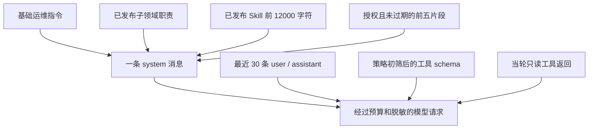

# 上下文、知识检索与工具调用

## 模型实际看见什么

数据库保存历史，模型只看见本次发送的输入，不会自行查询数据库，也没有永久记忆。

所有 Agent 统一使用 AgentScope。cold 和 prefork 共用 Node 原始模型消息、来源和工具治理，经 v1 模型/工具协议编排，关闭框架压缩、重试和状态注入，不将 Python 生成的上下文替换到供应商请求。prefork 的 v2 生命周期只复用 SDK 预加载父进程，每轮上下文与 Agent 均位于独立子进程。Responses reasoning 仅在 Node 当轮内存续传。运行边界见 [运行指南](agentscope-runtime.md)。

system 依次拼接基础指令、子领域、Skill 与知识。tools 是独立请求字段。通用 Agent 使用当前可读、启用且已发布的所有 Skill；子领域再取绑定交集，没有自动指令路由或自主 Agent 委派。可选独立复核是固定的分析→复核两个阶段，复核上下文不继承分析 system/Skill 指令、工具定义与 Responses reasoning，仅拿当前请求、已选择的历史/资料、本轮实际证据和候选答复作为待核实数据。

历史取最近 30 条 user/assistant，包括本次提问；每条最多 20,000 字符，错误消息与旧工具调用不是独立历史项。单 Skill 取前 12,000 字符，system 上限 80,000 字符。默认按消息窗口保留，不做自动摘要或跨会话记忆。

可选 `AGENT_CONTEXT_MODE=budgeted` 在这个窗口内按完整 user 轮次裁剪：移除起点孤立回答和最早轮次，保留当前问题；每次省略都告知模型/用户，并保存数量及前后字节统计。`AGENT_CONTEXT_MAX_BYTES` 默认 16000，以初始消息和工具 schema 的 UTF-8 JSON 字节计算，并取模型上下文减输出预留后的较小上限。系统指令、已选知识/Skill、工具定义和当前问题不裁剪，仍超限则拒绝。工具闭环开始后不再裁剪当前调用、结果或 opaque reasoning；后续轮次仍受原预算检查。这种确定性裁剪不需要额外模型请求，也不会把删掉的内容总结成新的事实。

## 预算与用量

execution 服务在开始时预留单轮预算，每次模型调用前按 JSON UTF-8 字节数量加最大输出做保守估算，并检查上下文与累计预算。请求显式包含 max_tokens。超过限额要求缩小范围，不会静默删除某条 Skill。

完成后累加每轮 usage；供应商未返回有效用量时采用估算。执行中心显示累计 token 与统一单价估算费用。估算不是厂商 tokenizer 的精确结果，也不是最终账单。并发预留可避免多个请求同时透支本地额度，供应商硬额度仍需单独配置。

MODEL_DATA_POLICY=block 时，发现常见凭据模式会拒绝发送；默认对 messages 中的匹配内容脱敏。基础正则无法识别所有业务敏感数据，企业数据出口政策仍需额外保障。

独立复核在构造 JSON 上下文前另行逐层保护内嵌 JSON 字符串，防止工具 content[].text 的转义隐藏凭据字段；保留 int64 数字文本，嵌套超过 12 层停止复核。该补强只作用于复核上下文，不能据此宣称分析阶段或所有业务字段均有结构化脱敏。

## 中文知识检索

保存知识时按 1,000 字符分片、750 步长建立持久 FTS5 索引。英文 / 数字词与中文相邻二元词被空格分开后索引。检索流程：

1. 从当前可读、启用且未过期资源中确定允许 ID。
2. 从本次问题提取最多 100 个关键词，FTS5 使用 OR 候选查询，最多读取 200 个候选。
3. 元数据命中每词加三分，正文命中每词加一分，选择最多五个正分片段。
4. 返回 resourceId、title、content、score、offset、revision、documentVersion、updated、sourceUrl。

默认 ranked 可能让同一文档的多个重叠片段占用多个名额。可选 `AGENT_RETRIEVAL_MODE=diverse` 在相同授权候选中先分配不同文档，再补非重叠片段，同文档最多两段、总计最多五段；可能牺牲单文档细节，需按真实问题验收。它只影响 Agent 检索，不改变独立知识搜索 API。分数是字符串相关性，不是概率；没有 embedding、语义改写或外部 reranker。

知识同步只支持受控来源的纯文本/Markdown，并保留本地权限，不自动继承企业 Wiki ACL。引用记录文档版本，但历史已交付的回答不会因资料撤权而追溯删除。

## 工具如何获准执行

前端 Skill/MCP 页的「查看工具清单」读取 `/api/resources` 已经过权限过滤的数据，展示允许列表与策略分类，支持搜索和服务筛选。它不查询远程工具描述或 schema，也不运行授权预检，因此「已配置策略」与实际获准执行是不同状态。缺失策略和停用服务会在目录标记；可调用性由下述执行链决定。

MCP 需要可读、启用、包含在子领域绑定中，且工具同时存在于 allowedTools 和 toolPolicies。工具策略初筛角色、用户、环境；实际调用再次验证当前身份、资源版本、JSON Schema、参数允许列表、数量和变更窗口。

工具目录缓存五分钟。缺失缓存时连接发现；失败向模型和用户明确报告本轮未取得该服务实时数据，继续使用其他资料。固定失败说明以 `metadata.mcpFailures` 保存到最终回答、待审批和错误消息，聊天刷新后仍展示“未取得实时数据”；原始异常、连接地址和凭据不写入该字段。发现失败没有工具步骤，不可当作成功查询，也不能用历史值确认当前状态。发现期间取消/超时直接结束，不再请求模型。实际执行重新发现，schema 与计划不一致则拒绝；实际调用失败保留在步骤账本。服务连续三次连接失败熔断 30 秒。每次执行连接在结束后关闭。

### 本轮只读查询目标

管理员可在只读工具策略声明 `requiredTargetFields`（最多八个字段）。聊天与定时任务把用户明确确认的 `{resourceId, tool, environment, arguments}` 随本轮输入提交；页面对策略限定的字段展示选项，任务把绑定保存为配置。一个绑定轮次只向模型提供该连接器的这一个工具，允许重复查询同一对象；若需要另一个对象或工具，发起新一轮并重新确认。模型所见目标值放在当前 user 输入，固定的执行规则留在 system 输入。

Node 在连接工具目录前核对绑定资源、工具、环境及策略，在模型工具调用批次和实际执行步骤前再次核对当前身份、资源版本、静态授权、Schema 与参数。受保护调用的字段集合和值必须与绑定完全一致，额外字段、授权内其他对象、工具结果诱导的改目标调用都拒绝，且不发出对应 `tools/call`。绑定计入持久 execution 输入及幂等摘要；审计、trace 和公开消息只保存步骤摘要，不公开绑定原值。旧任务的绑定为空时仍可执行普通任务，但调用受保护工具会被拒绝，可在任务的「查询目标」中补配。

目标来自认证用户在界面中的结构化确认，不是模型、检索文档或工具返回，也不从提问正文/附件猜测。若正文与选择冲突，平台只约束实际调用符合显式选择，不能证明用户想表达的自然语言与选择一致。未声明 `requiredTargetFields` 的既有工具仍维持旧行为；正式业务资源须更新策略并按真实场景验收后才能宣称该目标受保护。执行中心固定工具、Runbook 和 MCP 直接测试走各自原有策略，不使用聊天目标绑定。

模型工具名 mcp_N 是本轮内部映射，Skill 不应写死此编号。模型提出工具请求不代表已获授权，也不代表工具已经执行。

只读操作通过 execution 服务执行并保留步骤台账。写操作生成待审批计划，当前模型循环结束。用户在执行中心审核固定参数；审批成功后执行步骤与确定性核验，不自动继续先前模型循环。

所有调用经过安全出口客户端，远程响应默认最多 2 MB；给模型的结果文本另截断至 20,000 字符。截断文本不保证是完整 JSON。工具 isError 使执行失败；写调用发出后的失败标 unknown，等待核对实际状态。

## 持久化与恢复

| 内容 | 保存位置 |
| --- | --- |
| 问题、附件文本、最终回答、错误 | messages |
| runId、来源版本、调用摘要、MCP 发现失败、累计 usage | assistant metadata；已保存错误也保留本轮来源/工具/失败证据 |
| 可选上下文统计、结构化证据报告、双 Agent 复核结果 | message metadata.context / evidenceReport / agentReview，无新增表 |
| 请求幂等、运行状态、费用、关联会话 | executions |
| 工具目标、固定参数密文、审批、结果摘要、核验 | tool_steps |
| 事件关联、脱敏参数/结果、哈希链 | audit |
| 固定步骤、审核人与版本 | runbooks，计划加密 |

模型的完整工具往返仍只用于当前循环，模型隐藏推理不获取、不保存。进程中断不会自动重放工具。取消不能回滚远程操作；unknown 通过只读核验或人工接管处理。完整策略配置见 [生产治理](production.md)。

启用 `AGENT_EVIDENCE_REPORTS=true` 后，Node 按实际步骤/来源生成证据快照，可展开并导出 JSON。报告没有模型回答正文、工具参数或原始返回；它记录生成消息时的状态，不能替代后续审批记录或巡检健康判定。无成功工具证据、数据源失败、未完成步骤和历史省略均明确列出。
