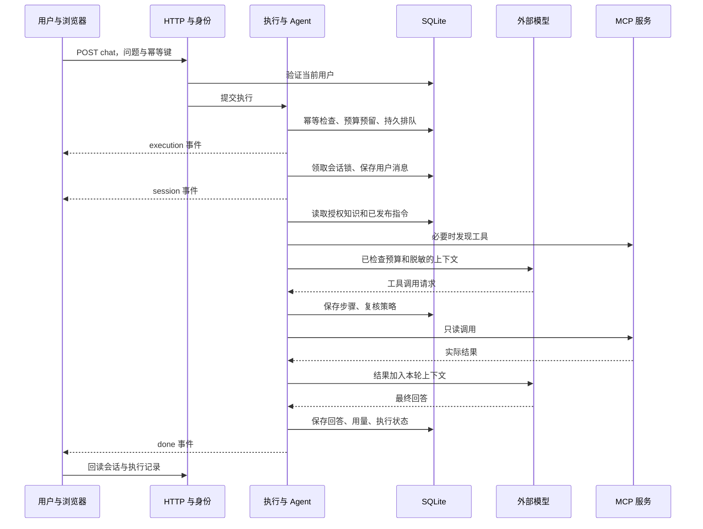

# 一次完整对话经过哪些节点

例子：“请查询 billing 服务状态，并结合手册给出排查建议。”前提是模型已配置，知识可读，Skill 已发布，MCP 的 service_status 被明确配置为当前用户可执行的只读工具。示例名称不代表真实生产服务。

## 时序

此图展示只读分支。写操作在保存计划后返回 awaiting_approval，之后由执行中心审批、执行、核验，不恢复原模型循环。

## 浏览器准备与身份

聊天页参考 Codex 客户端的简洁布局：浅灰侧栏、紧凑标题、独立滚动的阅读列与底部统一输入框，沿用运维百晓生原创品牌。侧栏可新建对话、查找本人已有摘要、打开工具与资源、项目文档和入门；查找仅在浏览器过滤已加载的列表，不发起模型请求。顶部显示当前对话标题，执行与审批、进入后台使用直接入口。折叠侧栏可再次展开；短横屏侧栏整体滚动，避免最近会话被底部设置挡住。

最近对话采用与 Codex 参考图一致的单行标题布局：14px文字、40px行高、圆角浅灰选中背景，不显示重复的会话图标；长标题省略并可悬停查看全文，右侧删除操作与标题同一行。移动导航沿用同一结构，并将行高与操作触控区域扩大。

“最近对话”标题右侧的垃圾桶图标（悬停提示「清理最近对话」，可访问名称「清理」）可删除当前已加载的本人会话（不受搜索筛选影响，最多300条；管理员列表包含他人会话时只清理本人部分）。每条对话旁提供垃圾桶按钮，鼠标悬停或键盘聚焦时显示，移动导航中始终可见。删除前确认数量和不可恢复范围；逐条调用既有删除接口，执行中的会话由后端拒绝并保留。部分失败显示实际成功/失败数量和原因，可重试剩余项；删除当前对话后回到新对话，刷新后仍保持服务器删除结果。清理同时永久删除对应消息，不清除执行审计记录。

点击「工作空间设置」立即打开固定高度的弹窗，读取期间显示「正在加载设置…」；配置返回、读取失败和切换页签均不改变弹窗位置。标题与页签保持可见，只有内容区滚动；关闭后回到原入口并保留聊天草稿。设置遮罩不做背景模糊，避免额外绘制开销。

欢迎页的问题示例只填入并聚焦草稿，另有「定制运维 Skill」与「AgentScope 入门」文字入口。用户消息右对齐灰色气泡，助手答复以无背景卡片的正文呈现，来源、工具、数据缺口、复核与全景按实际消息保留。阅读旧消息时不强制跟随新正文，可点击「返回最新消息」恢复跟随。

知识检索、独立复核和「允许委派」开关位于输入框内部，支持键盘与读屏状态；复核说明提示额外调用与等待。正文输入按草稿自动伸展，最多160px，窄屏按窗口高度进一步限制，超过时在输入框内滚动。附件、Agent、问答强度、模型名称与发送/停止在同一输入区。320px下控件换行，移动导航抽屉的开关不卸载聊天，也不丢失本次草稿；切换页面/新建对话仍按原规则重置。短横屏收起欢迎页的次要品牌文字与链接，问题示例必要时在自身区域横向滚动。上述导航、选择与编辑动作不触发模型，只有确认发送才进入下面的执行链。

打开本轮全景后，答复完成时会与最终消息一起替换实时图谱，保持弹窗和选中节点；不会在逐字显示收敛期间先清空实时图谱。失败或回读失败仍沿用原规则，不把暂态记录伪称历史。

聊天输入区的 Agent 入口有独立边框；菜单用图标、名称、用途说明和勾选标记区分候选，只有通用项时仍可查看说明。发送前可选择当前可见且启用的子领域；切换会清空已确认的查询目标，需要重新确认。已有会话显示锁图标并禁止切换，需要新建会话；生成期间也禁用入口。停用或不可见的关联不会误显示成通用。方向键/Home/End选择候选，Enter确认，Escape关闭并返回入口，Tab离开，外点关闭；窄屏菜单保持在视口内，长列表滚动。

需要显式目标绑定的只读工具在输入框上方显示「本轮查询目标」。表单采用浅灰圆角容器、白色输入和靠右的确认按钮，标题箭头提示展开/收起；单工具时服务名与工具名分层显示。DTS 的任务 ID 在桌面占更宽位置，窄屏字段纵向排列并在表单内滚动，确认按钮和问题输入保持可见。未填写必填字段时显示轻量错误文字、标记并聚焦对应字段，编辑后清除提示；确认后的目标摘要和状态使用绿色文字。聊天与任务配置复用此表单。点击确认只固定结构化目标，不执行查询；每轮发送后仍需重新确认，任务 ID 保留精确字符串，后端独立复核权限和参数。

Chat.send 检查问题非空、本人会话、当前未发送；同步提交锁阻止同一时刻连续 Enter 重复提交。文本附件拼入问题，总长最多 20,000 字符。在清空问题、附件和目标前先生成安全随机 requestKey；生成失败显示中文错误并保留未发送草稿。发送 JSON，Accept 为 application/x-ndjson。HttpOnly Cookie 自动随同源请求发送；gateway 模式的身份头由企业网关添加。

请求不携带客户端自称的用户角色，也不携带模型 Key。后端检查 Origin、JSON 类型与 1 MB 上限，再验证当前用户。配置的代理网段可用于正确识别真实 IP。

## 自主委派

开启「允许委派」后，主模型获得内部 delegate_agents 工具，可创建独立子 Agent 上下文并等待结果。默认关闭；只读子任务取主子授权资源交集，继承目标、预算、超时和取消。实际任务分派/子上下文/预算/模型/工具/回传/汇总节点在全景中按父子分组，消息同时显示实际子任务数和未完成数。子任务不创建侧栏会话；失败不能当成完成。完整流程与限制见[自主委派](agent-delegation.md)。

## 执行账本、排队与会话

execution 服务先检查用户与幂等键。同一用户同一键同一输入已有结果时返回原结果，不重复调用；键对应不同输入或执行正在进行时返回 409。请求先持久化，再等待全局与用户并发槽位；排队超时或额度不足会明确失败。

持久排队后、取得槽位前发 execution 事件携带 runId，表示已受理而非已经开始模型请求；排队中也可停止。取得槽位后，Agent 检查模型、会话所有权与子领域，领取整轮时限加30秒的会话租约（默认450秒），发送 session 并保存 user 消息。同一会话并发返回 409。执行记录可早于会话产生，因此配置失败也可在执行中心查询。

## 资源、检索与模型

通用模式使用可见且启用的资源，Skill/子领域额外要求 published。子领域按绑定 ID 取交集，空绑定不会退回全部资源。知识开关只控制本次检索，不关闭 Skill 或 MCP。

知识从权限与有效期过滤后的 FTS5 索引检索；Skill 正文、来源片段和历史按规则组成上下文。工具目录优先使用五分钟缓存；某个 MCP 发现失败会跳过该服务，明确告知模型本轮没有实时证据，并持久保存失败服务提示供回看。发现期间被取消或超时则直接终止。最终工具定义还经过角色、用户和环境初筛。

问答强度由聊天选择或系统模型默认确定，三档为 `low/medium/high`，服务商默认不发送 `reasoning` 参数。执行开始时固定有效强度，后续工具往返、同请求重试和独立复核不会受中途默认设置修改影响；定时任务沿用执行开始时系统默认。消息元数据与模型全景记录有效强度，旧记录不回填。这不冻结整轮模型名称或其他模型配置。

每次模型调用检查保守输入预算，发送 Responses `max_output_tokens`，应用凭据脱敏/阻断策略。最多六轮模型/工具往返，每轮最多六次网络尝试，每次最多十二个工具调用；工具按顺序执行，超出预算或次数即停止。

Responses SSE 在完成前断流、临时连接故障或 HTTP 408/429/500/502/503/504 时，可对当前模型请求最多重试五次（首次加重试共六次）。每次尝试默认等待首个数据块90秒；收到数据后若连续180秒没有新数据，也按超时恢复。管理员可在模型设置中把首字节改为1–120秒、静默改为60–600秒或填0禁用静默计时；两者都不放宽整轮默认420秒限制。重试采用400毫秒起的指数退避、上下10%随机抖动及5秒上限，优先不超过5秒的有效Retry-After（秒数或HTTP日期，0也有效）；要求等待更久时交给用户处理。每次恢复重新检查权限/预算，前一次失败用保守估算记账，可能提前用完本轮预算；不是供应商真实账单。恢复使用本次冻结模型配置和上下文，已完成工具结果直接复用，不重新执行工具。供应商failed只有错误码明确为 `server_error`、`service_unavailable`、`server_is_overloaded`、`rate_limit_exceeded` 或 `slow_down` 时可恢复；硬配额错误（含HTTP429中的insufficient_quota等固定额度码）、提示词等错误和未知码不恢复。当前 `store:false` 请求通过重新生成当前候选恢复，不是从供应商断点继续流。重试时取消旧显示队列，保留已经打印的未完成内容并标注“已保留生成内容，正在重新连接…”；状态区显示“等待首个数据块”或“流式响应已静默”及本次阈值。新一轮正文重新累计，超过当前已显示长度后才替换，完整终态可以直接替换为更短或不同的答复，不拼接不同尝试。取消、权限/预算/次数不足、非SSE、错误帧、无效JSON/UTF8、大小超限、供应商未知/非临时failed以及incomplete不自动恢复。普通聊天最多六轮工具往返；独立复核为分析五轮、复核一轮，每轮都可最多重试五次。实际网络尝试逐次记录，重试不占用工具往返轮数，但仍受整轮时间、用量预算和权限限制。

网页显示连接断开、缺少结束帧或45秒未收到任何数据（包括首次响应）时，只读找回原执行；后端正常每15秒发送 heartbeat。已收到 runId 时直接查询原执行；受理回包丢失时，按本人 requestKey 查询 `/api/executions/request/:requestKey`，再读取同一执行。查询总时限450秒、每次GET最多15秒、连续网络失败5次即停止，未找到本人执行则提示核对，不自动重新POST问题或工具。恢复期间保留已显示的未完成内容，成功后读回已保存答复；执行失败或恢复超时清除草稿并明确提示检查执行中心。离开聊天页立即停止显示读取和恢复等待，不撤销已受理的后端执行。

正文先排入显示队列，再按约32毫秒的节奏显示实际已收到的文字，积压越多越快追上；最终以完成正文收敛。减少动效偏好关闭逐字节奏。工具提议、失败和离页会清理旧队列和草稿，重试或显示断线只清理队列、保留已经显示的内容，独立复核仍在通过后一次发布正文。缓存未变化的历史Markdown，并只滚动消息容器；供应商实际暂停期间不会编造文字来掩盖等待。

若在聊天中显式开启“独立复核”，工具往返上限划分为分析五轮、复核一轮。分析完成后另起没有工具权限的 AgentScope Agent，只用已授权的文本背景、本轮工具证据和候选答复进行结构化复核。通过才展示原答复；拒绝、无效格式、模型故障或证据无法装入预算时使用固定提示。两个阶段共用本轮 token、超时和取消，候选草稿不会作为历史保存。审批计划跳过复核，仍由人审批；复核不撤销已发生的查询。细节见 [运行指南](agentscope-runtime.md#第六期独立证据复核)。

第四期可在首次模型请求前启用按完整轮次的历史预算裁剪和多文档检索。系统指令、当前问题、工具 schema 不被裁剪；工具循环内的请求/返回/reasoning 不再缩短。默认仍为原消息窗口与评分排序，具体开关见 [运行指南](agentscope-runtime.md)。

## 工具请求与实际执行

后端把模型内部工具名映射回真实服务，重新查询当前用户和资源。参数需符合 JSON Schema 与管理员的固定约束，资源版本、审批有效期、变更窗口也必须有效。

只读调用生成步骤账本并立即执行。写调用生成 encrypted arguments 与固定配置的审批计划，本轮返回待审批说明。生产或高风险需要另一位管理员；实际执行前仍再次检查所有权限，不因批准而跳过门禁。

写调用注入步骤 ID 作为幂等键，完成后运行指定只读核验。写调用发出后失败、取消、超时或核验未通过，标记 unknown。执行中心能只读核对，不能自动重复写入。

## 保存、进度与断线

正常回答保存 messages 与来源版本、工具摘要、累计用量；待审批和已保存错误消息也保留 runId、来源、已有工具摘要及独立的 MCP 发现失败信息。执行状态写 executions，步骤参数/核验写 tool_steps。连接关闭、会话锁释放后，路由发送 done。错误以 error 事件携带说明以及可能存在的 conversationId/runId。

启用证据报告后，Node 同时保存从实际步骤/来源构造的结构化快照；前端展开/导出，不额外请求模型。报告只标消息阶段，不判断业务健康，后续审批不会回写旧快照。

普通聊天会随模型生成逐步显示正文，不等待整段完成。正在生成的文本标为未完成；模型转入工具调用时撤下暂显正文，继续显示执行进度。可恢复的连接中断保留已显示草稿与重连提示；最终错误、取消或恢复失败会清除草稿；完成后保存并回读最终回答，刷新不会重复。上滚查看历史时不强制跟随最新文字。

NDJSON 事件包括 execution、session、progress、heartbeat、model_retry、message_start、message_delta、message_reset、done、error。每次模型网络尝试使用独立 streamId；model_retry 明确区分等待退避与建立连接，包含尝试次数、延迟及固定原因，不暴露供应商原始错误。开始流式响应的 HTTP 200 不代表业务成功，应检查终止事件。浏览器严格解码 UTF-8，显示帧缓冲上限2,000,000字符。上游模型使用 SSE；流式正文不包含工具参数、推理或复核内容。模型服务必须返回 Responses SSE，完整 JSON 响应将被拒绝；独立复核也通过 SSE 接收，但始终等通过后才发布回答。

仅接受 Responses 的 `response.completed` 终态、`status=completed` 和有效output；失败、未完成或缺少终态不保存半截答案，流中草稿清除。`output_text` 与 `refusal` 按输出顺序合并，工具结果用 `function_call_output/call_id` 续传。系统只使用 Responses，不尝试旧协议。

当前回复上方以灰色文字和细分隔线显示“已处理”耗时与当前动作，不使用独立状态卡片；尚未收到正文时显示于消息末尾。完成耗时读取已保存的全景记录，刷新后仍在；没有记录的历史消息不补造时间。输入框右下角发送箭头在生成期间切换为圆形停止按钮，上滚阅读历史仍能操作，按钮有“停止生成”的可访问名称与悬停说明。重试显示原因、次数与等待倒计时，正常正文或执行进度恢复后撤下重试状态。点击停止调用原执行的取消接口，等待退避也可取消，成功后显示“已停止生成，可继续提问”；尚未确认受理 ID 时停止按钮禁用。断线不会自动取消服务端执行；回到“执行与审批”查看原 runId 后决定下一步。取消会停止后续动作及本地等待，已发出的远程操作必须核对结果。重启把旧排队/运行标为 interrupted 或 unknown，保留待审批记录，不自动重放。

## 开源 Codex 对照

本轮参考 [Codex responses_retry.rs](https://github.com/openai/codex/blob/5ef96ab2785f3ecddf279639eff7b1b42c906fa4/codex-rs/core/src/responses_retry.rs) 及同一提交的客户端退避、Retry-After 和聊天流式状态处理：先通知重试再等待、等待可取消、正文与重试状态分别维护。采用400毫秒起的指数退避、上下10%随机抖动和5秒上限，优先有效的服务端短等待建议。本项目仍使用有界 Responses SSE 恢复和只读执行账本，不引入无限重连、协议回退或工具重放。参考提交固定为 `5ef96ab2785f3ecddf279639eff7b1b42c906fa4`。

更多限制和示例见 [上下文与工具](context-and-tools.md)、[生产治理](production.md)、[API 参考](reference.md)。

## 从页面回看实际处理路径

新会话每轮都记录「问答全景」，不依赖可选证据报告开关。展开消息下的「本轮全景」可查看实际选入资源、模型请求、工具、复核和发布结果的依赖与耗时；生成中也可查看实时快照。图谱不包含模型内部推理，待审批不显示为已执行，旧消息不回填。完整语义与断线边界见 [问答全景](execution-panorama.md)。
